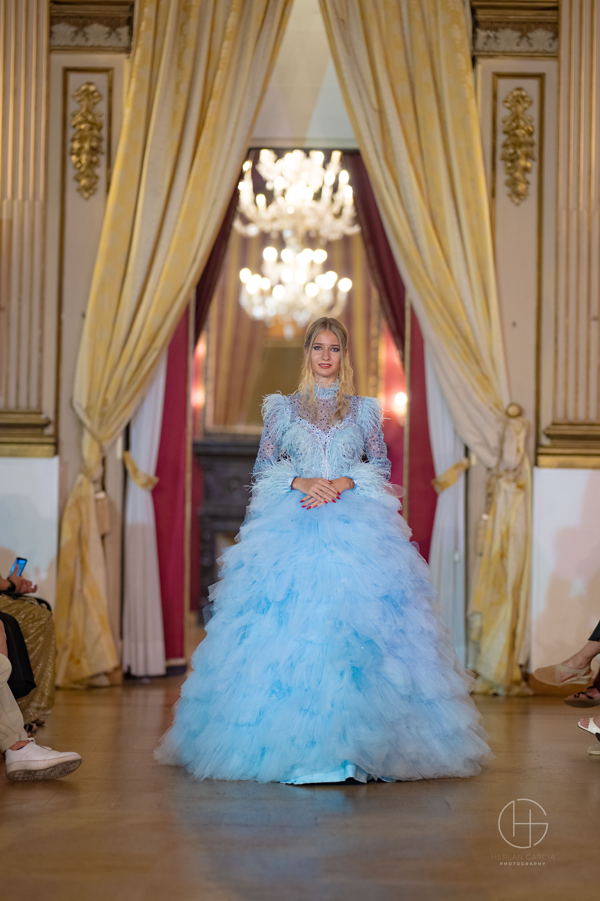

# Projekt 1

28.8 bis 18.09

## Grob-Planung

Ich mache einen Website über mich (Personal Portfolio Website). Ich brauche ihn für meine Modelling-Karierre. 
Der Website soll aus mehreren Bereichen bestehen ("Home", "About", "Modeling", "Dance", "IT" und "Contact")

Das habe ich schon gemacht:


https://github.com/user-attachments/assets/7afc4211-b305-4c4e-97e8-df23282779f4


## 28.8.2026
Ziele:
- [x] Struktur der Website planen (welche Bereiche die Website haben soll)
- [x] Projekt vorbereiten (Github Repository)
- [x] HTML Grundstruktur erstellen (erste Bereiche der Website einfügen)
- [x] Design mit CSS beginnen (Schriftarten, Farben, Positionen bestimmen)

Gemacht:
- Struktur geplant und Bereiche ("Home", "About", "Modeling", "Dance", "IT", "Contact");
''' <nav class="navbar">
    <div class="logo">Daria</div>

    <div class="nav-links">
        <a href="#home">Home</a>
        <a href="#about">About</a>
        <a href="#modeling">Modeling</a>
        <a href="#dance">Dance</a>
        <a href="#it">IT</a>
        <a href="#contact">Contact</a>
    </div>
</nav> '''
(Startseite mit meinem Namen und kurzen Beschreibung erstellt);

- Github Repository;
  
- HTML, CSS und Java Grundstruktur erstellt ('index.html', 'style.css', 'script.js');
  
- CSS mit HTML verbunden (<link rel="stylesheet" href="style.css">) ;
  
- JavaScript Datei verbunden (<script src="script.js"></script>);
  
- Schriftarten (Arial, sans-serif), Farben (#f7f7f7 (hell grau) und #fafafa (weiss))
  Positionen
 ''' .hero {
    min-height: 100vh;
    display: flex;
    justify-content: center;
    align-items: center;
    text-align: center;
}'''


## 4.9.2026
Ziele:
- [x] Inhalte vorbereiten (kurze texte schreiben, Bilder suchen);
- [x] HTML Bereich "About me" erstellen;
- [X] Bilder einfügen;
- [X] Design mit CSS verbessern (einheitliches Design, Bilder passend darstellen etc);
- [X] Website testen, Fehler korrigieren.

Gemacht:
- "About me" Bereich erstellt;
- Text über mich eingefügt;
- Ein eigenes Bild in die Website eingebaut
   ```<div class="about-image">
    
</div>```

  Wichtige Fehler bei mir:
  Falsch:
 ``` <div class="about-image">
</div>


```
  
Das Bild zuerst falsch eingebaut, weil der "img" Tag war ausserhalb von ".about-image", deshalb funktionierten die CSS Regeln für das Bild nicht. 

Korrigiert:
```
<div class="about-image">
    
</div>
```


- Bildgrösse und Darstellung angepasst:
```
 .about-image {
    width: 320px;
    height: 500px;
}

.about-image img {
    width: 100%;
    height: 100%;
    object-fit: contain;
}
```

- Layout für "About Me" mit Flexbox erstellt:
```
 .about-container {
    max-width: 1100px;
    width: 100%;
    margin: 0 auto;

    display: flex;
    gap: 50px;
    align-items: center;
    justify-content: center;
}
```

- Passende Darstellung für Handys begonnen:
```
 @media (max-width: 786px) {
    .about-container {
        flex-direction: column;
        gap: 40px;
    }
}
```
Dadurch werden Text und Bilder auf kleinen Bildschirmen untereinander angezeigt. 

## 11.09.2026
Ziele:
- [x] Website mit Github Pages veröffentlichen;
- [x] Darstellung für Handys testen;
- [x] Modeling Bereich beginnen;
- [x] Galerie für "Modeling" vorbereiten.

Gemacht:
- Website mit Github pages veröffentlicht; Dabei gelernt, dass die Hauptdatei 'index.html' heissen muss und dass Dateipfade auf GitHub korrekt sein müssen. 
- Einen Fehler mit dem Bildpfad gefunden
```
  
```
 funktioniert nur, wenn das Bild wirklich im Ordner images liegt. Da mein Bild direkt neben index.html liegt verwende ich:
  ```
  
```
- Navigation, Schriftgrössen und Layout für kleinere Bildschirme angepasst
  
```
  @media (max-width: 786px) {

    .navbar {
        padding: 20px;
        flex-direction: column;
        gap: 15px;
    }

    .hero h1 {
        font-size: 42px;
    }

    .about-container {
        flex-direction: column;
    }

}
```


- Modeling Bereich erstellt und dabei einen html Fehler gefunden
  Falsch: </section class="modeling" id="modeling">
  Das war falsch, weil ein schliessender </section> Tag keine Klasse oder ID bekommt. 

  Korrekt:
```
  </section>
<section class="modeling" id="modeling">
```

Danach konnte die Website wieder normal nach unten gescrollt werden. 


- Galerie für 'Modeling' vorbereitet.


## 18.09
Ziele:
- [ ] Modeling Galerie mit Bilder füllen;
- [ ] Modeling Bereich optisch verbessern;
- [ ] Dance Bereich erstellen;
- [ ] Erste Java Script Funktion einbauen;
- [ ] Navigation und Scroll Verhalten verbessern;
- [ ] Fehler korrigieren

Gemacht zu Hause am 11.09:
- Drei einfache Modeling Bilder in die Gallerie einfügen:
```
 <div class="modeling-gallery">
    
    
    
</div>
```

- Bilder mit CSS einheitlich darstellen
      

## 16.10
Ziele:
- [ ] Weiter an meiner persönlichen website arbeiten;
- [ ] HTML-Struktur kontrollieren und Fehler korrigieren;
- [ ] Modeling-Bereich weiterentwickeln;
- [ ] Dance-Bereich vorbereiten;
- [ ] Grundlagen von Random in C# lernen;

Gemacht:
- Zuerst habe ich nochmals die HTML-Struktur kontrolliert. Dabei habe ich gemerkt, dass schon kleine Fehler bei <section> oder <div> einen grossen Einfluss auf die ganze Website haben können.
Zum Beispiel hatte ich beim Modeling-Bereich zuerst einen falschen Section-Tag:
```
</section class="modeling" id="modeling">
```
Danach habe ich ihn korrigiert:
```
</section>
<section class="modeling" id="modeling">
```
Dadurch funktioniert auch der Link Modeling in meiner Navigation wieder richtig.
Meine Navigation verbindet jetzt die verschiedenen Bereiche der Website:
```
<a href="#home">Home</a>
<a href="#about">About</a>
<a href="#modeling">Modeling</a>
<a href="#dance">Dance</a>
<a href="#it">IT</a>
<a href="#contact">Contact</a>
```
- Ich habe auch weiter am Modeling Bereich gearbeitet. Dort habe ich eine Galerie mit mehreren Bildern erstellt.
```
<div class="modeling-gallery">

    <div class="gallery-box">
        
    </div>

    <div class="gallery-box">
        
    </div>

    <div class="gallery-box">
        
    </div>

</div>
```
Am Anfang hatten die Bilder verschiedene Grössen, weil die originalen Fotos unterschiedliche Formate haben. Deshalb habe ich sie mit CSS in gleich grosse Bereiche angepasst. 
```
.gallery-box {
    height: 560px;
    overflow: hidden;
}

.gallery-box img {
    width: 100%;
    height: 100%;
    object-fit: cover;
    object-position: center;
}
```
Jetzt sieht die Galerie viel besser und ordentlicher aus. 

- Danach habe ich mit dem nächsten Bereich der Website angefangen: 'Dance'.
Dort habe ich bereits einen Titel, einen kurzen Text und 2 Plätze für Tanzbilder erstellt
```
<section class="dance" id="dance">

    <div class="dance-container">

        <div class="dance-header">
            <p class="section-label">Dance</p>
            <h2>My passion for dance</h2>
        </div>

    </div>

</section>
```
Die richtige Tanzbilder möchte ich später noch auswählen und hinzufügen. 

- Neben meiner Website habe ich mich heute auch mit C# beschäftigt. Ich habe Klasse Random kennengelernt. Ein einfaches Beispiel:
```
Random random = new Random();

int computerzahl = random.Next(1, 51);
```
Damit erstellt das Programm eine zufällige Zahl zwischen 1 und 50. 
Danach habe ich versucht, diese Funktion in ein kleines Programm einzubauen, bei dem der Benutzer eine Zahl eingeben muss. 
```
Console.WriteLine("Position eingeben: ");
int guesser = Convert.ToInt32(Console.ReadLine());
```
Damit kann das Programm die Eingabe vom Benutzer lesen und als int speichern. 
Ich habe auch mit while-Schleife gearbeitet:
```
while (guesser != computerzahl)
{
    // weitere Versuche
}
```
Die Schleife läuft so lange weiter, bis die eingegebene Zahl mit der zufälligen Zahl übereinstimmt. 


## 23.10
Ziele:
- [ ] C# Randomizer weiter lernen;
- [ ] Mit Math.Abs() arbeiten;
- [ ] Hinweise abhängig von der Entfernung programmieren;
- [ ] Fehler suchen und korrigieren;
- [ ] So lange probieren den Randomizer Code zu schreiben, bis ich es ohne Fehler und ganz selbständig schreiben kann. 

Gemacht:
- Zuerst musste ich die Entfernung zwischen der eingegebenen Zahl und der zufälligen Zahl berechnen:
  ```
  int entfernung = Math.Abs(guesser - computerzahl);
  ```
Mit Math.Abs() bekomme ich immer positive Zahl. Das ist wichtig, weil die Entfernung nicht negativ sein soll. 

- Danach habe ich verschiedene Bedingungen eingebaut:
```
  if (entfernung > 15)
{
    Console.WriteLine("Sehr weit weg!");
}
else if (entfernung >= 6)
{
    Console.WriteLine("Du kommst näher!");
}
else if (entfernung >= 1)
{
    Console.WriteLine("Sehr heiss!");
}
else
{
    Console.WriteLine("Schatz gefunden!");
}
```
Dadurch reagiert das Programm unterschiedlich, je nachdem wie weit die eingegebene Zahl von der richtigen Zahl entfernt ist. 

- Meine Fehler:
zuerst habe ich nicht ganz verstanden, wo die Berechnung von 'entfernung' stehen muss. Später habe ich gemerkt, dass sie nach jeder neuen Eingabe neu berechnet werden muss. Ausserdem habe ich manchmal einige { oder } vergessen.
 

## 30.10
Ziele:
- [ ] Einen Versuchszähler einbauen, damit das Programm zählt, wie viele Eingaben der Benutzer braucht;
- [ ] Eine maximale Anzahl von Versuchen festlegen und danach das Spiel beenden oder die richtige Zahl anzeigen;
- [ ] Den IT Bereich meiner Website weiter ausbauen und neue Inhalte ergänzen;
- [ ] Mit dem Contact Bereich anfangen und die Navigation sowie das Design weiter verbessern. 

Gemacht:
- Randomizer weiterentwicklung. Ich habe einen Versuchszähler eingebaut, damit das Programm zählt, wie viele Versuche der Benutzer braucht.
Dafür habe ich zuerst eine neue Variable erstellt:
```
int versuche = 0;
```
Danach habe ich in der Schleife nach jeder Eingabe den Zähler erhöht. 
```
versuche ++;
```
So kann das Programm am Ende anzeigen, wie viele Versuche man gebraucht hat. Zum Beispiel:
```
Console.WriteLine("Du hast " + versuche + " Versuche gebraucht.");
```

- Danach habe ich an meiner Website weitergearbeitet. Ich habe den IT Bereich weiter ausgebaut und dort mehr Informationen über meine Schule und meine ersten IT Projekte ergänzt. Ich habe auch einen kleinen Untertitel eingebaut:
  ```
  <h3>My school has history.</h3>
  ```
  Danach habe ich den Text über die Alte Kanti ergänzt. Ich plane noch ein Paar Infos auch über den BBB hinzufügen.

- Ich habe auch nochmals die Navigation kontrolliert und geprüft, ob die Links zu den verschiedenen Bereichen richtig funktionieren.
  Zum Beispiel:
```
<a href="#home">Home</a>
<a href="#about">About</a>
<a href="#modeling">Modeling</a>
<a href="#dance">Dance</a>
<a href="#it">IT</a>
<a href="#contact">Contact</a>
```


## 06.11
Ziele:
- [ ] Beim C# Randomizer eine Möglichkeit einbauen, das Spiel nach dem Ende nochmals neu zu starten;
- [ ] Die Ausgabe vom Randomizer verbessern, damit der Benutzer am Ende klar sieht, ob er gewonnen oder verloren hat und wie viele Versuche gebraucht wurden;
- [ ] Den Contact Bereich meiner persönlichen Website fertigstellen;
- [ ] Im IT Bereich ein weiteres kleines Projekt oder eine Beschreibung von meinen bisherigen Informatik Aufgaben ergänzen;
- [ ] Das Design der Website weiter verbessern und kontrollieren, ob alle Bereiche auf dem Handy und auf dem Laptop gut aussehen.

Gemacht:

Heute habe ich zuerst wieder an meinem C# Randomizer gearbeitet.
Ich habe versucht, das Programm so zu machen, dass man nach dem Ende noch einmal spielen kann und nicht jedes Mal das Programm neu starten muss. Dafür habe ich nochmals mit Schleifen gearbeitet und geschaut, wie ich die Antwort vom Benutzer speichern kann.
```
Console.WriteLine("Willst du nochmal spielen? ja/nein");
string antwort = Console.ReadLine();
```
Ich habe auch die Ausgabe am Ende verbessert. Jetzt soll man besser sehen, ob man gewonnen oder verloren hat und wie viele Versuche man gebraucht hat.
```
Console.WriteLine("Du hast gewonnen!");
Console.WriteLine("Versuche: " + versuche);
```

Danach habe ich an meiner persönlichen *Website* weitergearbeitet.

Ich habe den IT-Bereich weiter ausgebaut und dort mehr Informationen über meine Schule und meine ersten Projekte ergänzt. Ich möchte dort später nicht nur meine Website zeigen, sondern auch kleine C# Projekte.

Zum Beispiel habe ich einen kleinen Untertitel eingefügt:
```
<h3>My school has history.</h3>
```
Ich habe auch weiter an der Struktur von der Website gearbeitet und kontrolliert, ob die Navigation richtig zu den einzelnen Bereichen führt.

Zum Beispiel:
```
<a href="#modeling">Modeling</a>
<a href="#dance">Dance</a>
<a href="#it">IT</a>
```
Damit die Links funktionieren, müssen die IDs bei den Bereichen genau gleich heissen:
```
<section class="modeling" id="modeling">
<section class="dance" id="dance">
<section class="it" id="it">
```
Ausserdem habe ich nochmals kontrolliert, wie die Website auf dem Handy aussieht. Bei kleineren Bildschirmen sollen die Inhalte untereinander stehen und nicht aus dem Bildschirm rausgehen.

Dafür benutze ich zum Beispiel:
```
@media (max-width: 786px) {
    .project-cards {
        grid-template-columns: 1fr;
    }
}
```
